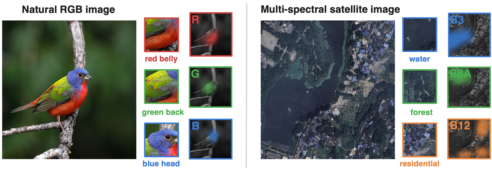
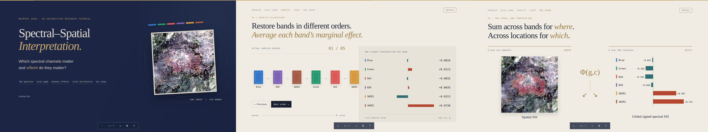
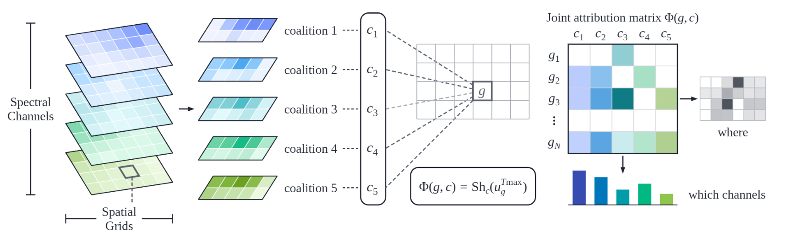
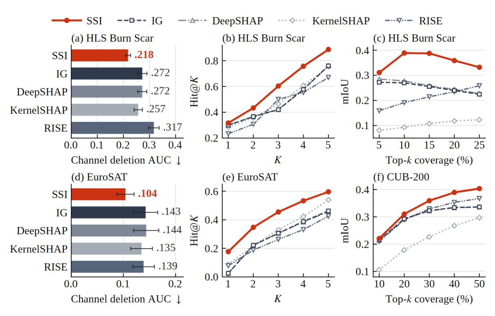
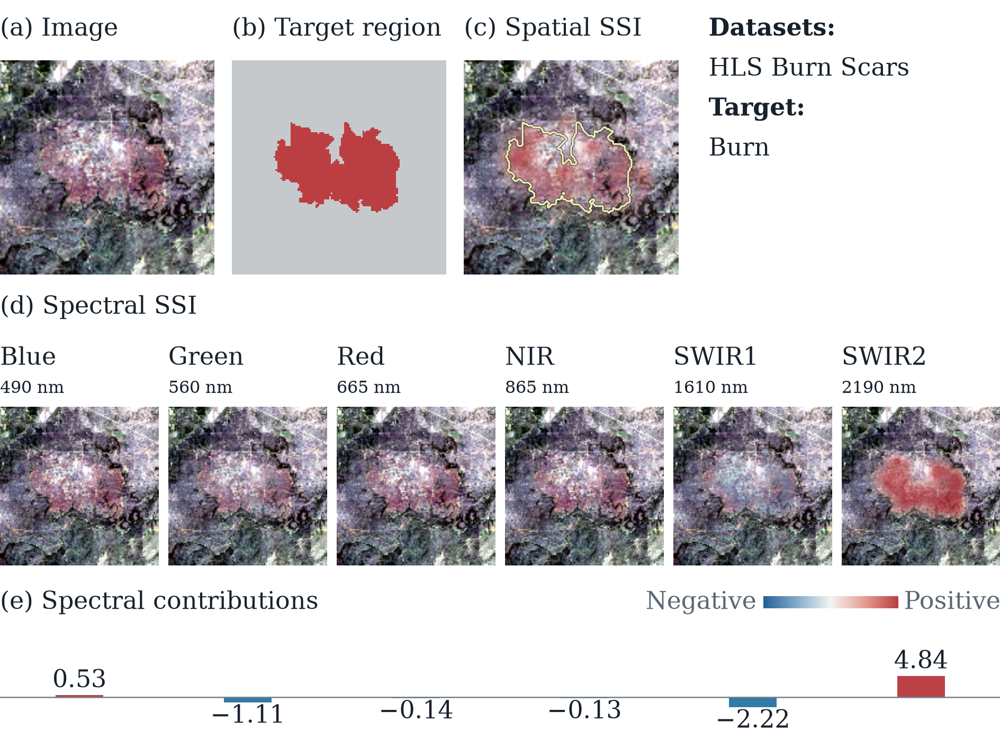

# 🔥 SSI: Spectral-Spatial Interpretation

**Which spectral channels matter, and where?** SSI explains a model score with signed attributions for each spatial cell and channel. It keeps the surrounding image fixed while allocating a cell's contribution among its channels using Shapley values.

<p align="center">
  <strong>Haotian Ma, Ruqi Yang, Philip Townsend</strong> &nbsp;&nbsp;🎇Accepted by NeurIPS 2026!
</p>

<p align="center">
  <a href="https://arxiv.org/abs/2610.21114">📄 Paper</a> &nbsp;·&nbsp;
  <a href="https://atheavenma.github.io/Spectral-Spatial-Interpretation/playground/">🎛️ Playground</a> &nbsp;·&nbsp;
  <a href="examples/README.md">🖼️ Visual Atlas</a> &nbsp;·&nbsp;
  <a href="https://atheavenma.github.io/Spectral-Spatial-Interpretation/">🎞️ 5-minute tutorial</a>
</p>

<div align="center">
  
</div>

https://github.com/user-attachments/assets/f9697c02-6253-441b-9c15-96abec099b7b

### 🎞️ 5-Minute Tutorial

<p align="center">
  <a href="https://atheavenma.github.io/Spectral-Spatial-Interpretation/"></a>
</p>

💻 Click to open the [tutorial](https://atheavenma.github.io/Spectral-Spatial-Interpretation/) in your browser · [Tutorial guide](docs/TUTORIAL.md)

### 💡 How SSI Works

A channel's contribution can change across an image. SSI asks how the channels **within one spatial cell** affect the chosen model score, conditioned on the **observed values of all other cells**.

<p align="center">
  
</p>

For spatial cell `g`, let `S_g` be its channels and `B_g` all players outside the cell. Let `f` be the scalar model score, and let `x_A` denote the input with players outside `A` replaced by the specified baseline. The conditional game is

$$
w_g(R)=f(x_{B_g\cup R})-f(x_{B_g}), \qquad R\subseteq S_g.
$$

SSI allocates that contrast using ordinary Shapley values within the cell:

$$
\Phi(g,c)=\mathrm{Sh}_c(w_g), \qquad \sum_c \Phi(g,c)=f(x)-f(x_{B_g}).
$$

The resulting attribution matrix has shape **(spatial cells, channels)**. Summing over channels gives a spatial map; summing over cells gives a spectral summary. Values can be positive or negative.

**What the guarantee means.** Channel contributions sum to the score change from masking their *own cell*. When different cells interact, their totals do not necessarily sum to the overall input-to-baseline score change. SSI explains a conditional local game rather than the context-averaged Owen game.

The standalone [NumPy implementation](ssi.py) supports exact subset enumeration and sampled channel permutations.

### 📊 Main Results

The NeurIPS 2026 paper compares SSI with Integrated Gradients (IG), DeepSHAP, KernelSHAP, and a rank-1 RISE control. The main settings use **16 × 16 grids for CUB-200** and **8 × 8 grids for EuroSAT and HLS Burn Scars**, with the per-channel mean masking baseline.

Lower deletion AUC and higher insertion AUC are better. Entries are **paper-reported mean ± bootstrap standard deviation**, not outputs of the bundled demo; bold denotes the lowest or highest reported mean.

#### 🦜 CUB-200 · RGB classification

| Method | Joint deletion ↓ | Rank-1 deletion ↓ | Insertion ↑ |
|---|:---:|:---:|:---:|
| 🧩 **SSI** | **.0088±.001** | **.0104±.001** | **.7132±.019** |
| IG | .0112±.001 | .0126±.001 | .2895±.022 |
| DeepSHAP | .0112±.001 | .0127±.001 | .2853±.022 |
| KernelSHAP | .0178±.001 | .0222±.002 | .3481±.019 |
| RISE | .0183±.001 | .0183±.001 | .6886±.017 |

#### 🛰️ EuroSAT · 13-band classification

| Method | Joint deletion ↓ | Rank-1 deletion ↓ | Insertion ↑ |
|---|:---:|:---:|:---:|
| 🧩 **SSI** | **.1397±.020** | **.1682±.021** | **.7319±.023** |
| IG | .2097±.030 | .2267±.030 | .6621±.029 |
| DeepSHAP | .2078±.029 | .2255±.031 | .6614±.028 |
| KernelSHAP | .2434±.027 | .2824±.028 | .5767±.030 |
| RISE | .2130±.026 | .1969±.023 | .7091±.023 |

#### 🔥 HLS Burn Scar · 6-band segmentation

| Method | Joint deletion ↓ | Rank-1 deletion ↓ | Insertion ↑ |
|---|:---:|:---:|:---:|
| 🧩 **SSI** | **.1545±.008** | **.1657±.010** | **.6638±.008** |
| IG | .2160±.011 | .2723±.015 | .6291±.009 |
| DeepSHAP | .2149±.011 | .2704±.016 | .6321±.009 |
| KernelSHAP | .2096±.012 | .2558±.016 | .5500±.008 |
| RISE | .2888±.016 | .2871±.015 | .6130±.009 |

✅ SSI has the best reported mean for all three metrics on all three datasets under both masking baselines.
For example, mean-baseline HLS joint deletion is .1545 for SSI versus .2096 for KernelSHAP, the strongest
non-SSI method on that metric.

<p align="center">
  
</p>

*SSI leads the compared methods in spatial localization, spectral Hit@K, and channel deletion across the evaluated datasets.*

### 🎛️ Interactive SSI Playground

**All 57 Atlas examples are playable in HTML** with verified model checkpoints and original inputs. Change the grid size and permutations to recompute SSI. The Python API also exports Atlas PNG, JSON and NPZ, with configurable baselines.

<p align="center">
  <a href="https://atheavenma.github.io/Spectral-Spatial-Interpretation/playground/"></a>
</p>

**[🎛️ Play with SSI ↗](https://atheavenma.github.io/Spectral-Spatial-Interpretation/playground/)** · [Visual Atlas — 57 examples](examples/README.md) · [**Checkpoint + image → Atlas PNG + JSON**](docs/ATLAS_API.md)

### 🚀 Quick Start

```bash
git clone https://github.com/AtheavenMa/Spectral-Spatial-Interpretation.git
cd Spectral-Spatial-Interpretation
python -m pip install -r requirements.txt
```

To explain your own model, provide its model-ready image, a fixed class target and a dataset-level channel baseline vector:

```python
from ssi import SSI

result = SSI(
    model=my_model,
    input=my_image,                   # CHW tensor
    target=6,                        # fixed output class
    baseline=dataset_channel_mean,   # one numeric value per channel
    image_size=(128, 128),           # model input resolution
    grid_size=16,                    # pixels per cell -> 8 x 8 cells
    permutations=5,
).explain()

spatial, spectral = result.spatial, result.spectral
```

Inputs and baseline must use the model's preprocessing. See the [Core SSI API guide](docs/CORE_API.md) for segmentation, numerical outputs and parameter details.

### 🙏 Appreciation

This project uses the [HLS Foundation Burnscars Dataset](https://huggingface.co/datasets/ibm-nasa-geospatial/hls_burn_scars)
by Christopher Phillips, Sujit Roy, Kumar Ankur and Rahul Ramachandran (2023),
[DOI: 10.57967/hf/0956](https://doi.org/10.57967/hf/0956), and the MIT convolution blocks from
[mateuszbuda/brain-segmentation-pytorch](https://github.com/mateuszbuda/brain-segmentation-pytorch/blob/d45f8908ab2f0246ba204c702a6161c9eb25f902/unet.py).
The upstream source is vendored unchanged with its [license](LICENSES/brain-segmentation-pytorch-MIT.txt) and
[pinned provenance](third_party/provenance.json). 

📄 **Paper.** Haotian Ma, Ruqi Yang, and Philip Townsend. *Spectral-Spatial Interpretation*. NeurIPS 2026.
See [CITATION.cff](CITATION.cff) for citation metadata.

### 📜 License

Code and documentation are licensed under **MIT**, Copyright © 2026 SSI contributors. See [LICENSE](LICENSE).
HLS data and derived materials retain **CC-BY-4.0** attribution. The bundled model weights and manuscript figures are
not covered by the root MIT license. See [third-party notices](THIRD_PARTY_NOTICES.md).

### 📚 Citation

If you use this work, please cite the paper:

```bibtex
@inproceedings{ma2026spectral,
  title = {Spectral-Spatial Interpretation},
  author = {Haotian Ma and Ruqi Yang and Philip Townsend},
  booktitle = {Advances in Neural Information Processing Systems},
  year = {2026},
  eprint = {2610.21114},
  archivePrefix = {arXiv},
  url = {https://arxiv.org/abs/2610.21114}
}
```
