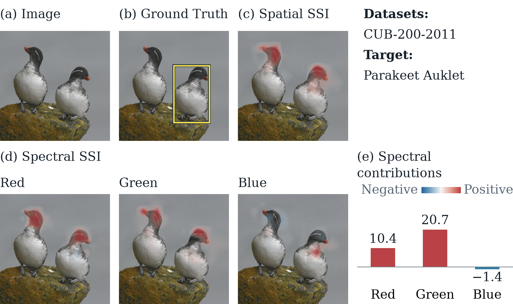
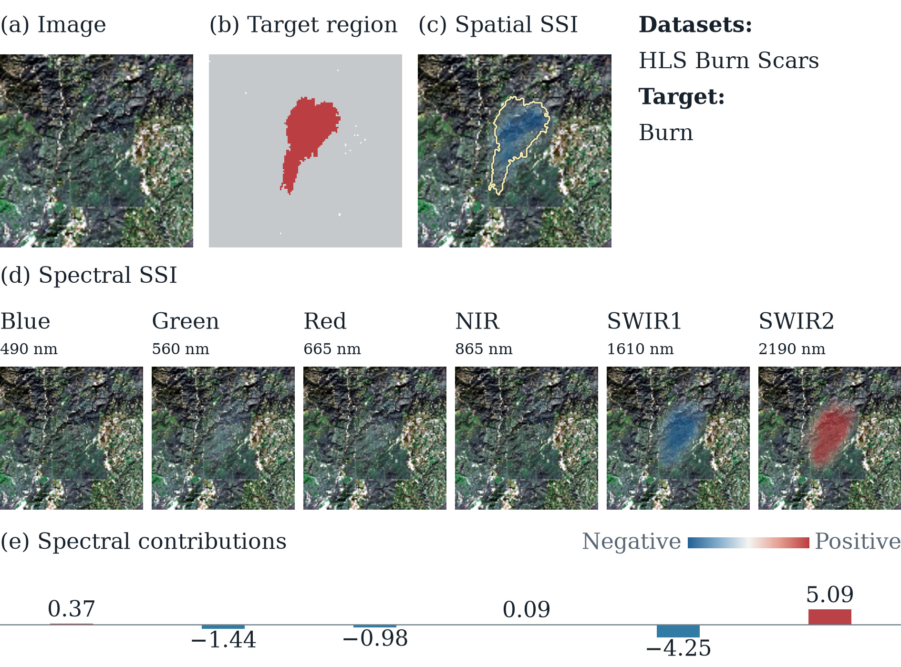
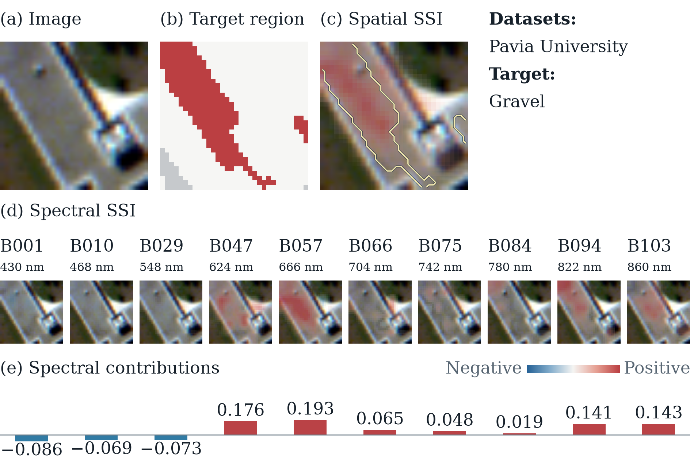
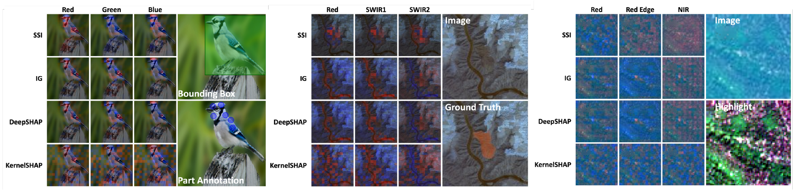
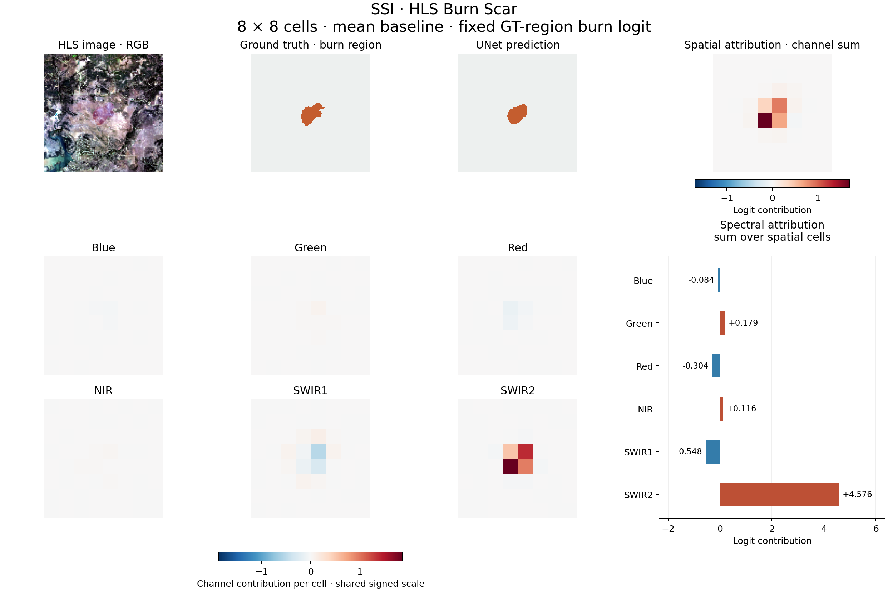

# 🔥 SSI: Spectral-Spatial Interpretation

**Which spectral channels matter, and where?** SSI explains a model score with signed attributions for each spatial cell and channel. It keeps the surrounding image fixed while allocating a cell's contribution among its channels using Shapley values.

<p align="center">
  <b>Accepted at NeurIPS 2026</b> &nbsp;·&nbsp;
  <a href="https://arxiv.org/abs/2610.21114">📄 Paper</a> &nbsp;·&nbsp;
  <a href="examples/README.md">🖼️ Visual Atlas</a> &nbsp;·&nbsp;
  <a href="#-quickstart">🚀 Quickstart</a>
</p>

<p align="center">
  
</p>

A spatial heatmap shows **where** evidence appears; a global spectral ranking shows **which channels** matter overall. SSI retains both axes instead of assuming the same channel profile at every location.

---

## 🖼️ SSI in Action

**57 visualizations · 6 datasets · RGB, multispectral, and hyperspectral imagery.**

These are illustrative, pre-rendered SSI visualizations. They are **not** an additional quantitative benchmark, and not every dataset has a bundled runnable model adapter.

### 🦜 RGB · CUB-200

<p align="center">
  <a href="examples/CUB_200/"></a>
</p>

### 🔥 Multispectral · HLS Burn Scars

<p align="center">
  <a href="examples/HLS_BurnScars/"></a>
</p>

### 🌈 Hyperspectral · Pavia University

<p align="center">
  <a href="examples/PaviaU/"></a>
</p>

**Explore all 57 figures in the [SSI Visual Atlas](examples/README.md).**

| RGB | Multispectral | Hyperspectral |
|---|---|---|
| [CUB-200](examples/CUB_200/) · 10 | [EuroSAT](examples/EuroSAT/) · 10 | [PaviaU](examples/PaviaU/) · 10 |
| | [HLS Burn Scars](examples/HLS_BurnScars/) · 10 | [Salinas](examples/Salinas/) · 10 |
| | | [WHU-Hi-LongKou](examples/WHU_Hi_LongKou/) · 7 |

---

## 💡 How SSI Works

A channel's contribution can change across an image. SSI asks how the channels **within one spatial cell** affect the chosen model score, conditioned on the **observed values of all other cells**.

<p align="center">
  
</p>

For spatial cell `g`, let `S_g` be its channels and `B_g` all players outside the cell. Let `f` be the scalar model score, and let `x_A` denote the input with players outside `A` replaced by the specified baseline. The conditional game is

$$
w_g(R)=f(x_{B_g\cup R})-f(x_{B_g}), \qquad R\subseteq S_g.
$$

SSI allocates that contrast using ordinary Shapley values within the cell:

$$
\Phi(g,c)=\operatorname{Sh}_c(w_g), \qquad \sum_c \Phi(g,c)=f(x)-f(x_{B_g}).
$$

The resulting attribution matrix has shape **(spatial cells, channels)**. Summing over channels gives a spatial map; summing over cells gives a spectral summary. Values can be positive or negative.

**What the guarantee means.** Channel contributions sum to the score change from masking their *own cell*. When different cells interact, their totals do not necessarily sum to the overall input-to-baseline score change. SSI explains a conditional local game rather than the context-averaged Owen game.

The standalone [NumPy implementation](ssi.py) supports exact subset enumeration and sampled channel permutations.

---

## 📊 Main Results

The NeurIPS 2026 paper compares SSI with Integrated Gradients (IG), DeepSHAP, KernelSHAP, and a rank-1 RISE control. The main settings use **16 × 16 grids for CUB-200** and **8 × 8 grids for EuroSAT and HLS Burn Scars**, with the per-channel mean masking baseline.

Lower deletion AUC and higher insertion AUC are better. Entries are **paper-reported mean ± bootstrap standard deviation**, not outputs of the bundled demo; bold denotes the lowest or highest reported mean.

#### 🦜 CUB-200 · RGB classification

| Method | Joint deletion ↓ | Rank-1 deletion ↓ | Insertion ↑ |
|---|:---:|:---:|:---:|
| 🧩 **SSI** | **.0088±.001** | **.0104±.001** | **.7132±.019** |
| IG | .0112±.001 | .0126±.001 | .2895±.022 |
| DeepSHAP | .0112±.001 | .0127±.001 | .2853±.022 |
| KernelSHAP | .0178±.001 | .0222±.002 | .3481±.019 |
| RISE | .0183±.001 | .0183±.001 | .6886±.017 |

#### 🛰️ EuroSAT · 13-band classification

| Method | Joint deletion ↓ | Rank-1 deletion ↓ | Insertion ↑ |
|---|:---:|:---:|:---:|
| 🧩 **SSI** | **.1397±.020** | **.1682±.021** | **.7319±.023** |
| IG | .2097±.030 | .2267±.030 | .6621±.029 |
| DeepSHAP | .2078±.029 | .2255±.031 | .6614±.028 |
| KernelSHAP | .2434±.027 | .2824±.028 | .5767±.030 |
| RISE | .2130±.026 | .1969±.023 | .7091±.023 |

#### 🔥 HLS Burn Scar · 6-band segmentation

| Method | Joint deletion ↓ | Rank-1 deletion ↓ | Insertion ↑ |
|---|:---:|:---:|:---:|
| 🧩 **SSI** | **.1545±.008** | **.1657±.010** | **.6638±.008** |
| IG | .2160±.011 | .2723±.015 | .6291±.009 |
| DeepSHAP | .2149±.011 | .2704±.016 | .6321±.009 |
| KernelSHAP | .2096±.012 | .2558±.016 | .5500±.008 |
| RISE | .2888±.016 | .2871±.015 | .6130±.009 |

✅ SSI has the best reported mean for all three metrics on all three datasets under both masking baselines.
For example, mean-baseline HLS joint deletion is .1545 for SSI versus .2096 for KernelSHAP, the strongest
non-SSI method on that metric. The complete zero-baseline comparison is below.

**Across these three datasets, SSI has the best reported mean for all three metrics.** These metrics assess rankings under the paper's deletion and insertion protocols, rather than proving that every individual attribution is correct.

Additional results cover zero baselines, spatial localization, spectral aggregation, MC-Owen comparisons, and different spatial grid sizes. See the **[complete paper results and settings](docs/PAPER_RESULTS.md)**.

<p align="center">
  
</p>

*Qualitative comparisons from the paper. The quantitative evaluations are reported in the tables.*

---

## ⚙️ Install

Use Python 3.10 or newer, preferably in a virtual environment.

```bash
git clone https://github.com/AtheavenMa/Spectral-Spatial-Interpretation.git
cd Spectral-Spatial-Interpretation
python -m pip install -r requirements.txt
```

`ssi.py` needs only NumPy. The demo also needs PyTorch and Matplotlib. The prepared sample and weights are bundled, so
no dataset or model download is needed at runtime. See the [setup guide](docs/HLS_DEMO.md#installation) for environment
and platform details.

---

## 🚀 Quickstart

```python
import numpy as np
from ssi import explain

def score(s):  # Boolean masks: (batch, cells, channels); True keeps a player
    return (2*s[:, 0, 0] + 4*s[:, 0, 1]
            + 6*(s[:, 0, 0] & s[:, 0, 1])
            + 8*(s[:, 0, 0] & s[:, 1, 0]))

r = explain(score, n_cells=2, n_channels=2)
print(r.attribution)        # [[13.  7.], [ 8.  0.]]
print(r.spatial)            # [20.  8.]
print(r.position_contrasts) # [20.  8.]
assert np.allclose(r.spatial, r.position_contrasts)
```

💡 This game has two cells and two channels, with interactions both within and between cells. Each cell's channel
scores sum to its masking contrast: 20 for the first cell and 8 for the second.

On a real model, supply `value_fn(masks)` returning one scalar per coalition. Keep the target, baseline and any region of interest fixed for all calls. [hls.py](hls.py) is a complete image-to-model adapter with bounded batch sizes.

👉 On HLS Burn Scar

```bash
python demo.py
```

---

## 🔥 HLS Burn Scar Demo

The included demo explains a **128 × 128, six-band HLS image** with an **8 × 8 spatial grid** and **10 channel permutations per cell** by default. Its scalar target is the burn-class logit averaged over a fixed ground-truth burn region; the default baseline is the training-split channel mean.

The bundled input is an **illustrative training-split sample**, not a held-out test example. The prepared sample and checkpoint run offline after installing dependencies.

```bash
python demo.py
python demo.py --baseline zero
python demo.py --method exact --output outputs/hls_exact
```

<p align="center">
  <a href="assets/demo_output.png"></a>
</p>

The demo saves a visualization, NumPy attribution arrays, and a JSON summary. See the [HLS demo guide](docs/HLS_DEMO.md) for model and sample provenance, preprocessing, CLI options, expected output, and validation commands.

**Important distinction:** the [Visual Atlas](examples/README.md) contains pre-rendered figures across six datasets; the self-contained runnable demo uses the bundled HLS sample and pretrained UNet adapter.

---

## 📖 Documentation

| Resource | Description |
|---|---|
| [Visual Atlas](examples/README.md) | All 57 visualizations grouped by dataset |
| [Complete paper results](docs/PAPER_RESULTS.md) | Tables, evaluation settings, and comparisons |
| [HLS demo guide](docs/HLS_DEMO.md) | Runnable demo, configuration, inputs, and outputs |
| [Core API](ssi.py) | Standalone NumPy implementation |
| [Unit tests](tests/) | Mathematical and adapter regression checks |

## 🙏 Appreciation

This project uses the [HLS Foundation Burnscars Dataset](https://huggingface.co/datasets/ibm-nasa-geospatial/hls_burn_scars)
by Christopher Phillips, Sujit Roy, Kumar Ankur and Rahul Ramachandran (2023),
[DOI: 10.57967/hf/0956](https://doi.org/10.57967/hf/0956), and the MIT convolution blocks from
[mateuszbuda/brain-segmentation-pytorch](https://github.com/mateuszbuda/brain-segmentation-pytorch/blob/d45f8908ab2f0246ba204c702a6161c9eb25f902/unet.py).
The upstream source is vendored unchanged with its [license](LICENSES/brain-segmentation-pytorch-MIT.txt) and
[pinned provenance](third_party/provenance.json). 

📄 **Paper.** Haotian Ma, Ruqi Yang, and Philip Townsend. *Spectral-Spatial Interpretation*. NeurIPS 2026.
See [CITATION.cff](CITATION.cff) for citation metadata.

---

## 📜 License

Code and documentation are licensed under **MIT**, Copyright © 2026 SSI contributors. See [LICENSE](LICENSE).
HLS data and derived materials retain **CC-BY-4.0** attribution. The bundled model weights and manuscript figures are
not covered by the root MIT license. See [third-party notices](THIRD_PARTY_NOTICES.md).

---

## 📚 Citation

If you use this work, please cite the paper:

```bibtex
@inproceedings{ma2026spectral,
  title = {Spectral-Spatial Interpretation},
  author = {Haotian Ma and Ruqi Yang and Philip Townsend},
  booktitle = {Advances in Neural Information Processing Systems},
  year = {2026},
  eprint = {2610.21114},
  archivePrefix = {arXiv},
  url = {https://arxiv.org/abs/2610.21114}
}
```
