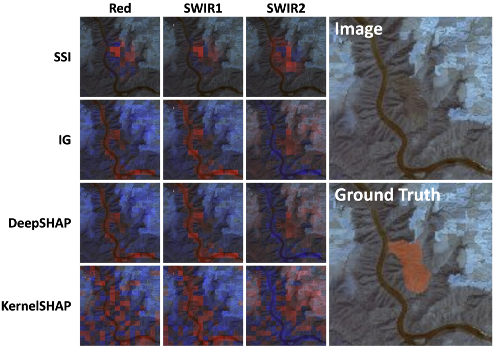

# 🔥 SSI: Spectral-Spatial Interpretation

👉 TL;DR. A spectral channel can matter differently across an image. SSI explains **which channels matter, and where**
by holding the surrounding image fixed and allocating each spatial cell's contribution among its channels using
Shapley values. The result is a signed spatial–spectral map, with spatial and channel summaries. The core is one NumPy
file, and the bundled HLS Burn Scar demo runs offline after installation.

<p align="center">
  <b>📄 Accepted at NeurIPS 2026</b> &nbsp; | &nbsp;
  <a href="#-demo"><b>🧪 Demo</b></a>
</p>

## 🎥 Overview

<p align="center">
  
</p>

**Figure 1.** Spectral channels carry spatially distinct information. A spatial heatmap summarizes where evidence lies;
a global channel ranking summarizes which bands matter overall. SSI preserves both axes by assigning a signed score
to every spatial cell and channel.

---

## ✨ Highlights

- 🧮 **Joint attribution.** One score per spatial cell and channel, with spatial and spectral summaries.
- 🧭 **Observed context.** All other cells stay at their observed values while the channels inside one cell are varied.
- 🧩 **Local Shapley allocation.** Exact subset enumeration or channel-permutation sampling.
- 📏 **Checkable aggregation.** Summing a cell's channel scores recovers the score drop from masking that entire cell.
- ⚡ **Small core.** [ssi.py](ssi.py) depends only on NumPy and accepts a batched scoring function.
- 🔥 **Runnable example.** A six-band HLS image, its real burn mask and a small pretrained UNet are included.

---

## 💡 Why SSI?

The importance of a spectral channel can vary across an image. A band useful for identifying burned vegetation may contribute differently in a nearby unburned region. Multiplying a spatial map by one global channel vector constrains every location to the same spectral profile.

SSI instead asks: **given the rest of this observed image, how do the channels at this location contribute to the chosen model score?** It preserves spatial variation in channel relevance and supports both RGB and multispectral inputs.

---

## 📐 What SSI Computes

<p align="center">
  
</p>

**Figure 2.** SSI holds the surrounding image fixed and allocates each spatial cell's contribution among its channels.

🎯 **The intervention.** Let a player be a cell/channel pair $`(g,c)`$. For a target cell $`g`$, let $`S_g`$ contain its channels, and let $`B_g`$ contain every player outside that cell. Missing players are replaced by a specified baseline. With model score $`f`$, define

$$w_g(R)=f(x_{B_g\cup R})-f(x_{B_g}), \qquad R\subseteq S_g.$$

🧩 **Spectral-Spatial Interpretation.** SSI applies the ordinary Shapley value within this conditional game:

$$\Phi(g,c)=\mathrm{Sh}_c(w_g), \qquad
\sum_c\Phi(g,c)=f(x)-f(x_{B_g}).$$

✅ **Local efficiency.** Channel scores sum to the contrast from masking their entire cell. The baseline and scalar
target are part of the explanation's definition. Scores can be positive or negative. When spatial positions interact,
the sum over all cells need not equal the full input-to-baseline contrast. SSI therefore answers a different question
from globally efficient, context-averaged Owen attribution.

🎲 **Estimation.** `method="auto"` enumerates all subsets when there are at most three channels; otherwise it samples 10 permutations per cell by default. `method="exact"` enumerates all subsets, and `method="permutation"` always samples. Complete permutation paths preserve the local sum at finite sample counts; individual channel scores can still have sampling error.

📊 **Outputs.** `attribution` has shape `(cells, channels)`. `spatial` sums over channels; `spectral` sums over cells. Scores remain at cell resolution. Repeating cell scores across pixels is a display operation, not an additional attribution computation.

---

## 🔎 Comparison of Methods

🔗 **Joint faithfulness across five methods.** Table 1 compares SSI with IG, DeepSHAP, KernelSHAP and the
RISE rank-1 control on the same grid-cell/channel players. The main grids are 16 × 16 on CUB-200 and
8 × 8 on EuroSAT and HLS Burn Scar. All tables below use the **per-channel mean baseline** unless noted.

📏 **Reading the tables.** Lower joint and rank-1 deletion AUC is better; higher grid-sum insertion AUC is better.
Values are **mean ± bootstrap standard deviation**, from 1,000 bootstrap resamples as reported in the manuscript.
Bold marks the best reported mean in each column, not a statistical significance test.

📝 These are **paper-reported results**, not outputs of the bundled demo. See the
[complete numerical tables](docs/PAPER_RESULTS.md) for settings and all thresholds.

#### 🦜 CUB-200 · RGB classification

| Method | Joint deletion ↓ | Rank-1 deletion ↓ | Insertion ↑ |
|---|:---:|:---:|:---:|
| 🧩 **SSI** | **.0088±.001** | **.0104±.001** | **.7132±.019** |
| IG | .0112±.001 | .0126±.001 | .2895±.022 |
| DeepSHAP | .0112±.001 | .0127±.001 | .2853±.022 |
| KernelSHAP | .0178±.001 | .0222±.002 | .3481±.019 |
| RISE | .0183±.001 | .0183±.001 | .6886±.017 |

#### 🛰️ EuroSAT · 13-band classification

| Method | Joint deletion ↓ | Rank-1 deletion ↓ | Insertion ↑ |
|---|:---:|:---:|:---:|
| 🧩 **SSI** | **.1397±.020** | **.1682±.021** | **.7319±.023** |
| IG | .2097±.030 | .2267±.030 | .6621±.029 |
| DeepSHAP | .2078±.029 | .2255±.031 | .6614±.028 |
| KernelSHAP | .2434±.027 | .2824±.028 | .5767±.030 |
| RISE | .2130±.026 | .1969±.023 | .7091±.023 |

#### 🔥 HLS Burn Scar · 6-band segmentation

| Method | Joint deletion ↓ | Rank-1 deletion ↓ | Insertion ↑ |
|---|:---:|:---:|:---:|
| 🧩 **SSI** | **.1545±.008** | **.1657±.010** | **.6638±.008** |
| IG | .2160±.011 | .2723±.015 | .6291±.009 |
| DeepSHAP | .2149±.011 | .2704±.016 | .6321±.009 |
| KernelSHAP | .2096±.012 | .2558±.016 | .5500±.008 |
| RISE | .2888±.016 | .2871±.015 | .6130±.009 |

✅ SSI has the best reported mean for all three metrics on all three datasets under both masking baselines.
For example, mean-baseline HLS joint deletion is .1545 for SSI versus .2096 for KernelSHAP, the strongest
non-SSI method on that metric. The complete zero-baseline comparison is below.

<details>
<summary>Show the zero-baseline comparison · Table 1, lower block</summary>

**CUB-200**

| Method | Joint deletion ↓ | Rank-1 deletion ↓ | Insertion ↑ |
|---|:---:|:---:|:---:|
| 🧩 **SSI** | **.0063±.000** | **.0072±.001** | **.5224±.017** |
| IG | .0083±.001 | .0085±.001 | .0832±.013 |
| DeepSHAP | .0083±.000 | .0084±.001 | .0802±.012 |
| KernelSHAP | .0154±.001 | .0327±.003 | .1523±.011 |
| RISE | .0142±.001 | .0144±.001 | .4246±.021 |

**EuroSAT**

| Method | Joint deletion ↓ | Rank-1 deletion ↓ | Insertion ↑ |
|---|:---:|:---:|:---:|
| 🧩 **SSI** | **.0763±.015** | **.0850±.017** | **.6001±.024** |
| IG | .1434±.023 | .1874±.029 | .4983±.033 |
| DeepSHAP | .1444±.024 | .1876±.028 | .4963±.032 |
| KernelSHAP | .1521±.017 | .1862±.020 | .4257±.031 |
| RISE | .1599±.019 | .1741±.023 | .5644±.029 |

**HLS Burn Scar**

| Method | Joint deletion ↓ | Rank-1 deletion ↓ | Insertion ↑ |
|---|:---:|:---:|:---:|
| 🧩 **SSI** | **.1203±.009** | **.1175±.010** | **.6564±.008** |
| IG | .1785±.010 | .1802±.011 | .6140±.009 |
| DeepSHAP | .1776±.010 | .1802±.011 | .6174±.009 |
| KernelSHAP | .1555±.009 | .1637±.009 | .5503±.008 |
| RISE | .1971±.010 | .2229±.010 | .6116±.008 |

</details>

<details>
<summary>How the compared methods differ</summary>

🔗 **Explaining spatial and spectral evidence.** Methods differ in how they vary the input and handle the surrounding
context. Dense attribution methods can also retain channel information; SSI's distinction is its conditional game and
local aggregation rule.

| Method | Attribution view / allocation | Treatment of external context |
|---|:---:|:---:|
| Integrated Gradients | Dense channel-resolved input attribution; can be aggregated into cells | Integrates gradients along a baseline-to-input path |
| DeepSHAP | Dense channel-resolved attribution; aggregated within cells | Uses background reference samples |
| KernelSHAP | Flat cell/channel players | Samples coalitions across the full player set |
| RISE × global channel score | Rank-1 spatial–spectral map | Random spatial masks plus global channel perturbations |
| Owen value | Hierarchical cell/channel allocation | Averages over external spatial coalitions |
| 🧩 **SSI** | **Shapley allocation among channels within each cell** | **Fixes every other cell to its observed value** |

The demo runs SSI only; these other methods are not runtime dependencies.

</details>

---

## ⚙️ Install

Use Python 3.10 or newer, preferably in a virtual environment.

```bash
git clone https://github.com/AtheavenMa/Spectral-Spatial-Interpretation.git
cd Spectral-Spatial-Interpretation
python -m pip install -r requirements.txt
```

`ssi.py` needs only NumPy. The demo also needs PyTorch and Matplotlib. The prepared sample and weights are bundled, so
no dataset or model download is needed at runtime. See the [setup guide](docs/HLS_DEMO.md#installation) for environment
and platform details.

---

## 🚀 Quickstart

```python
import numpy as np
from ssi import explain

def score(s):  # Boolean masks: (batch, cells, channels); True keeps a player
    return (2*s[:, 0, 0] + 4*s[:, 0, 1]
            + 6*(s[:, 0, 0] & s[:, 0, 1])
            + 8*(s[:, 0, 0] & s[:, 1, 0]))

r = explain(score, n_cells=2, n_channels=2)
print(r.attribution)        # [[13.  7.], [ 8.  0.]]
print(r.spatial)            # [20.  8.]
print(r.position_contrasts) # [20.  8.]
assert np.allclose(r.spatial, r.position_contrasts)
```

💡 This game has two cells and two channels, with interactions both within and between cells. Each cell's channel
scores sum to its masking contrast: 20 for the first cell and 8 for the second.

On a real model, supply `value_fn(masks)` returning one scalar per coalition. Keep the target, baseline and any region of interest fixed for all calls. [hls.py](hls.py) is a complete image-to-model adapter with bounded batch sizes.

👉 On HLS Burn Scar

```bash
python demo.py
```

---

## 📊 Main Results

The comparisons below examine spatial localization, spectral rankings, external-context averaging and grid size.
They retain the manuscript's reported uncertainty; the [complete tables](docs/PAPER_RESULTS.md) include every
coverage threshold and Hit@K value. The main method comparison is in [Comparison of Methods](#-comparison-of-methods).

<details>
<summary><b>🧭 Tables 8–9. Spatial localization</b></summary>

Sum channel attributions within each cell, retain the top-scoring spatial coverage, and measure mIoU against
spatial annotations. CUB averages cover Top-10/20/30/40/50%; HLS averages cover Top-5/10/15/20/25%.
The average columns are copied from the paper, including their bootstrap standard deviations.

| Method | CUB average mIoU ↑ | HLS average mIoU ↑ | HLS Top-10% mIoU ↑ |
|---|:---:|:---:|:---:|
| 🧩 **SSI** | **.3366±.0044** | **.3555±.0065** | **.3886±.0131** |
| IG | .3001±.0034 | .2523±.0075 | .2699±.0162 |
| DeepSHAP | .2999±.0033 | .2584±.0076 | .2776±.0157 |
| KernelSHAP | .2152±.0026 | .1045±.0050 | .0932±.0101 |
| RISE | .3096±.0038 | .2116±.0048 | .1913±.0116 |

SSI's reported average mIoU is .3366 on CUB and .3555 on HLS, versus .3096 and .2584 for the strongest
non-SSI methods on those respective averages. EuroSAT is omitted from spatial localization because the paper
does not use a spatially discriminative annotation proxy for that dataset.

</details>

<details>
<summary><b>🌈 Tables 10–11. Spectral aggregation</b></summary>

Sum over spatial cells to rank channels. Channel deletion masks entire bands in that order. Hit@K is the fraction
of the class's prior-band set recovered among the top K channels, averaged over the evaluated samples;
it measures agreement with the specified spectral priors.

**HLS Burn Scar · Table 10**

| Method | Channel deletion ↓ | Hit@1 ↑ | Hit@3 ↑ | Hit@5 ↑ |
|---|:---:|:---:|:---:|:---:|
| 🧩 **SSI** | **.2180±.0094** | **.3167±.0068** | **.6033±.0159** | **.8867±.0163** |
| IG | .2724±.0178 | .3000±.0092 | .4200±.0154 | .7600±.0148 |
| DeepSHAP | .2723±.0174 | .3000±.0103 | .4233±.0160 | .7600±.0151 |
| KernelSHAP | .2568±.0161 | .2833±.0120 | .4633±.0163 | .7533±.0145 |
| RISE | .3166±.0204 | .2333±.0153 | .5000±.0192 | .6700±.0034 |

**EuroSAT · Table 11**

| Method | Channel deletion ↓ | Hit@1 ↑ | Hit@3 ↑ | Hit@5 ↑ |
|---|:---:|:---:|:---:|:---:|
| 🧩 **SSI** | **.1039±.0165** | **.1768±.0231** | **.4545±.0323** | **.5960±.0264** |
| IG | .1426±.0231 | .0258±.0115 | .3061±.0313 | .4624±.0335 |
| DeepSHAP | .1437±.0241 | .0258±.0113 | .3061±.0306 | .4573±.0358 |
| KernelSHAP | .1347±.0209 | .0879±.0205 | .3295±.0330 | .5394±.0366 |
| RISE | .1387±.0207 | .0788±.0181 | .2629±.0288 | .4258±.0242 |

SSI has the lowest reported channel deletion AUC and highest Hit@K at all five reported K values on both datasets.
Hit@2 and Hit@4 are included in the [complete tables](docs/PAPER_RESULTS.md#tables-10-11-spectral-aggregation).

</details>

<details>
<summary><b>🤝 Table 2. SSI versus MC-Owen on HLS Burn Scar</b></summary>

Both methods group players by spatial cell. SSI fixes the observed external context; MC-Owen averages over
external spatial coalitions. Table 2 reports the following means and bootstrap standard deviations.

| Metric | SSI | MC-Owen |
|---|:---:|:---:|
| Joint deletion ↓ | **.155±.008** | .173±.010 |
| Rank-1 deletion ↓ | **.166±.010** | .254±.017 |
| Channel deletion ↓ | **.218±.009** | .261±.017 |
| Grid-sum insertion ↑ | **.664±.008** | .627±.009 |
| Spatial mIoU at Top-5% ↑ | **.311±.012** | .299±.018 |
| Spatial mIoU at Top-15% ↑ | **.387±.014** | .254±.017 |
| Spatial mIoU at Top-25% ↑ | **.332±.017** | .224±.017 |
| Spectral Hit@1 ↑ | **.317±.007** | .287±.011 |
| Spectral Hit@3 ↑ | **.603±.016** | .460±.017 |
| Spectral Hit@5 ↑ | **.887±.016** | .730±.013 |

SSI has the better reported mean on all ten metrics in this comparison. These methods explain different games;
the table compares their attribution rankings under the paper's evaluation protocol. The evaluation counts reported in the paper are not wall-clock runtime measurements.

</details>

<details>
<summary><b>🔲 Tables 4–7. Robustness to spatial grid size</b></summary>

The appendix compares all five methods on HLS 4 × 4, CUB 4 × 4 and 8 × 8, and EuroSAT 4 × 4 grids with the
per-channel mean baseline. SSI has the best reported mean for all three faithfulness metrics in these settings.

**Table 4. HLS Burn Scar · 4 × 4**

| Method | Joint deletion ↓ | Rank-1 deletion ↓ | Insertion ↑ |
|---|:---:|:---:|:---:|
| 🧩 **SSI** | **.1544±.0082** | **.1588±.0097** | **.6310±.0077** |
| IG | .2499±.0159 | .2792±.0171 | .5739±.0089 |
| DeepSHAP | .2481±.0145 | .2793±.0176 | .5835±.0089 |
| KernelSHAP | .2129±.0149 | .2534±.0179 | .5651±.0080 |
| RISE | .4320±.0188 | .4330±.0190 | .5327±.0070 |

**Table 5. CUB-200 · 4 × 4**

| Method | Joint deletion ↓ | Rank-1 deletion ↓ | Insertion ↑ |
|---|:---:|:---:|:---:|
| 🧩 **SSI** | **.0239±.0011** | **.0264±.0013** | **.7267±.0111** |
| IG | .0257±.0012 | .0284±.0015 | .6515±.0149 |
| DeepSHAP | .0259±.0012 | .0279±.0013 | .6511±.0146 |
| KernelSHAP | .0263±.0012 | .0285±.0013 | .6900±.0124 |
| RISE | .0329±.0017 | .0329±.0015 | .7109±.0113 |

**Table 6. CUB-200 · 8 × 8**

| Method | Joint deletion ↓ | Rank-1 deletion ↓ | Insertion ↑ |
|---|:---:|:---:|:---:|
| 🧩 **SSI** | **.0123±.0007** | **.0154±.0010** | **.7567±.0116** |
| IG | .0152±.0008 | .0169±.0010 | .5215±.0213 |
| DeepSHAP | .0151±.0008 | .0170±.0010 | .5204±.0221 |
| KernelSHAP | .0169±.0008 | .0240±.0016 | .5688±.0188 |
| RISE | .0225±.0013 | .0225±.0012 | .7425±.0118 |

**Table 7. EuroSAT · 4 × 4**

| Method | Joint deletion ↓ | Rank-1 deletion ↓ | Insertion ↑ |
|---|:---:|:---:|:---:|
| 🧩 **SSI** | **.1295±.0158** | **.1425±.0155** | **.7096±.0195** |
| IG | .1957±.0233 | .1745±.0217 | .6731±.0224 |
| DeepSHAP | .1963±.0234 | .1750±.0217 | .6730±.0223 |
| KernelSHAP | .1416±.0199 | .1458±.0181 | .6432±.0240 |
| RISE | .2116±.0272 | .2120±.0263 | .7007±.0188 |

</details>

#### 🖼️ Figure 4. Qualitative comparisons across three datasets

<p align="center">
  
</p>

[Figure 4](assets/figures/fig4.png) compares channel-resolved maps from SSI, IG, DeepSHAP and KernelSHAP on CUB,
HLS and EuroSAT. These examples illustrate localization and channel variation; the quantitative evidence is in the
tables above. The HLS panel remains in the [Demo](#-demo) section, and all figures are in the [Figure Map](#-figure-map).

---

<a id="hls-burn-scar-demo"></a>

## 🧪 Demo

`demo.py` runs SSI on a **128 × 128 HLS image with 6 bands, an 8 × 8 grid and 10 permutations per cell**. The score is the
burn-class logit averaged over a **fixed ground-truth burn region**. The default uses the training-split mean baseline;
`--baseline zero` uses zero reflectance before normalization. The bundled image belongs to the training split and is an
illustrative example, not a held-out benchmark.

```bash
python demo.py
python demo.py --baseline zero
python demo.py --method exact --output outputs/hls_exact
```

```text
permutation | 2152 scored inputs | 107 batches
Full GT-region logit: 2.371968 | sample burn IoU: 0.8144
Max local-efficiency error: 1.388e-17
  Blue   -0.083984
  Green  +0.178652
  Red    -0.304284
  NIR    +0.115718
  SWIR1  -0.547710
  SWIR2  +4.576118
```

The channel totals summarize signed contributions under this target and baseline. Attribution took about **6.5
seconds** on the recorded CPU setup, excluding loading and plotting. Runtime and floating-point results can vary
across machines. The demo saves `demo_output.png`, `attribution.npz` and `summary.json` under `outputs/hls_demo/`.

<p align="center">
  
</p>

**Figure 4, HLS panel.** Paper illustration comparing SSI, IG, DeepSHAP and KernelSHAP across Red, SWIR1 and SWIR2, with
the image and ground truth. The runnable demo uses a separate bundled sample; its [actual output](assets/demo_output.png)
and [recorded summary](assets/demo_summary.json) remain available.

✅ The HLS demo uses the bundled six-channel UNet adapter and pretrained weights. Model architecture and
asset provenance are described in the [HLS guide](docs/HLS_DEMO.md).

📖 See the [HLS demo guide](docs/HLS_DEMO.md) for preprocessing, custom inputs, CLI options, output interpretation,
repository layout and test commands.

---

## 🗺️ Figure Map

Descriptions summarize the manuscript figures and the runnable HLS demo.

| Figure | Content | In the demo |
|---|---|:---:|
| [Figure&nbsp;1](assets/figures/fig1.png) | Spatially distinct spectral evidence | ✅ HLS illustration |
| [Figure&nbsp;2](assets/figures/fig2.png) | Observed-context SSI construction | ✅ |
| [Figure&nbsp;4](assets/figures/fig4.png) | Qualitative maps on CUB, HLS and EuroSAT | ✅ HLS, separate sample |
| Manuscript Table 1 | Joint / rank-1 deletion and grid-sum insertion | — |
| Manuscript Table 2 | SSI versus MC-Owen | — |
| [HLS paper panel](assets/figures/hls_paper_comparison.png) | HLS comparison panel from Figure 4 | — Paper illustration |
| [Demo output](assets/demo_output.png) | Bundled sample and checkpoint | ✅ `python demo.py` |

<details>
<summary>Show all figures</summary>

| | |
|---|---|
| <br>Figure 1 | <br>Figure 2 |
| <br>Figure 4 | |

</details>

---

## 🙏 Appreciation

This project uses the [HLS Foundation Burnscars Dataset](https://huggingface.co/datasets/ibm-nasa-geospatial/hls_burn_scars)
by Christopher Phillips, Sujit Roy, Kumar Ankur and Rahul Ramachandran (2023),
[DOI: 10.57967/hf/0956](https://doi.org/10.57967/hf/0956), and the MIT convolution blocks from
[mateuszbuda/brain-segmentation-pytorch](https://github.com/mateuszbuda/brain-segmentation-pytorch/blob/d45f8908ab2f0246ba204c702a6161c9eb25f902/unet.py).
The upstream source is vendored unchanged with its [license](LICENSES/brain-segmentation-pytorch-MIT.txt) and
[pinned provenance](third_party/provenance.json). 

📄 **Paper.** Haotian Ma, Ruqi Yang, and Philip Townsend. *Spectral-Spatial Interpretation*. NeurIPS 2026.
See [CITATION.cff](CITATION.cff) for citation metadata.

---

## 📜 License

Code and documentation are licensed under **MIT**, Copyright © 2026 SSI contributors. See [LICENSE](LICENSE).
HLS data and derived materials retain **CC-BY-4.0** attribution. The bundled model weights and manuscript figures are
not covered by the root MIT license. See [third-party notices](THIRD_PARTY_NOTICES.md).
